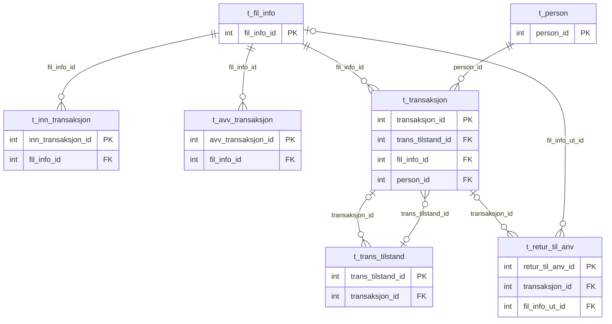
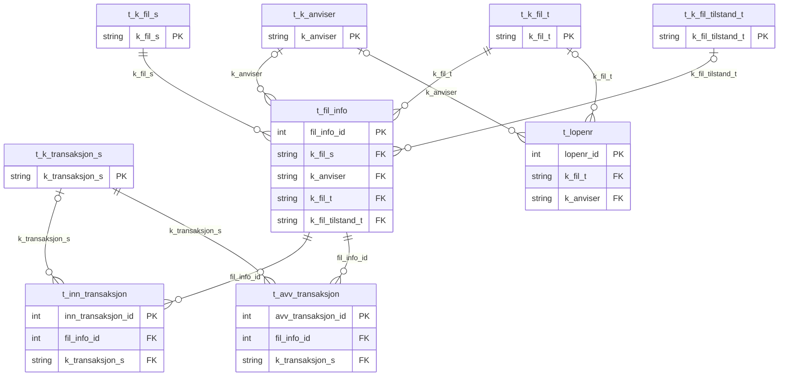
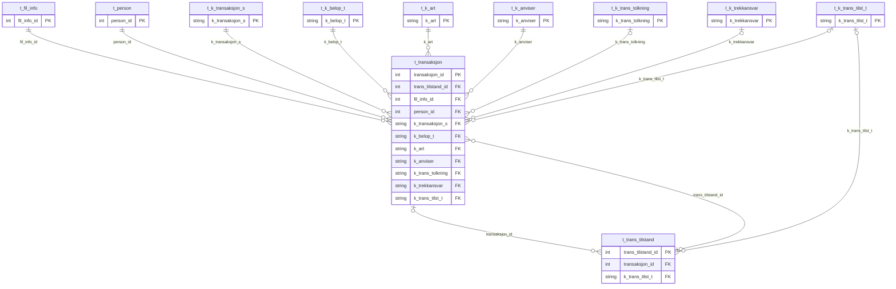
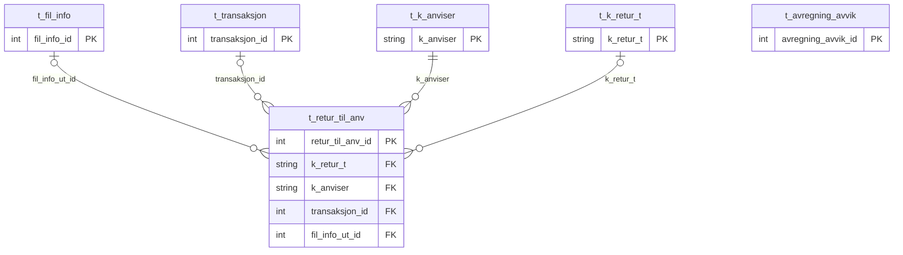
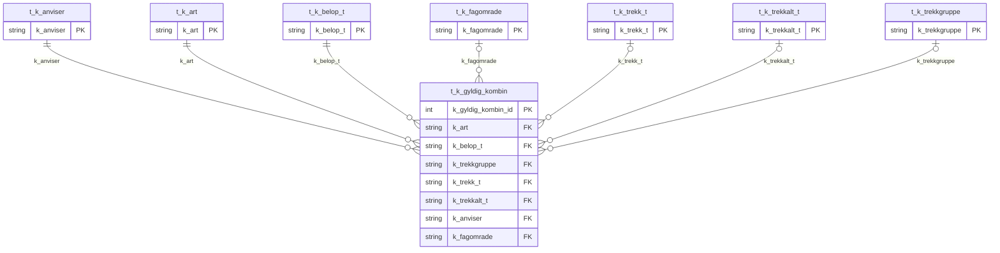

# Transaksjonsskjema

Skapt fra DDL for produksjonsdatabasen 2026-10-07. Skjemaet omfatter de 11 tabellene som brukes av applikasjonen, og de 
14 tilhørende kodeverkstabellene. Historiske TEMP/FSDRIFT-tabeller, eldre batchtabeller og øvrige tabeller som ikke
brukes i kodebasen er utelatt.

Diagrammene er delt inn etter fagområde for å gjøre tekst og relasjoner lesbare. Oversikten viser bare tabellene 
som inngår i behandlingsflyten. Deldiagrammene viser alle deklarerte fremmednøkler og tilhørende kodeverkstabeller. 
Diagrammene viser bare primærnøkler (PK) og fremmednøkler (FK). Fullstendige kolonnedefinisjoner med datatyper, lengder, 
regler for NULL, identitetsinnstillinger, nøkler og indekser finnes i 
[`V1.0.2__create_transaction_schema.sql`](../../backend/src/main/resources/db/migration/V1.0.2__create_transaction_schema.sql).

Tabell- og kolonnenavn er skrevet med små bokstaver uten skjemaprefiks. PostgreSQL tolker navn med store bokstaver 
uten anførselstegn i applikasjonens SQL som de samme navnene. Db2-spesifikke innstillinger for tegnkoding, tabellområder, 
lagring og fysisk indeksoppsett er utelatt. Fremmednøklene opprettes etter tabellene for å håndtere den sirkulære 
avhengigheten mellom `t_transaksjon` og `t_trans_tilstand`. De kontrolleres ved hver SQL-setning og kan ikke utsettes 
til transaksjonen avsluttes.

Alle de 42 ikke-unike indeksene fra kilden er beholdt med opprinnelig kolonnerekkefølge. De unike indeksene fra kilden 
tilsvarer primærnøkler eller unikhetsregler og erstattes av disse. Db2-innstillingen `INCLUDE NULL KEYS` påvirker ikke 
unikhetsreglene for disse indeksene: Alle unike nøkler er enten primærnøkler eller unikhetsregelen for `t_person.fnr_fk`, 
som ikke tillater NULL. PostgreSQLs standardbehandling av NULL i unike nøkler gir derfor samme resultat.

Migreringen oppretter bare skjemaet. Den kopierer ikke data og endrer ikke applikasjonens tilkobling til Db2. Flyway 
kjøres ved oppstart av applikasjonen og oppretter tabellene i det konfigurerte PostgreSQL-skjemaet. Etter import av 
eksplisitte verdier i identitetskolonner må hver sekvens justeres slik at neste genererte verdi er større enn den høyeste 
importerte verdien.

## Oversikt over behandlingsflyten

Oversikten viser de sentrale tabellene i behandlingsflyten og bare primær- og fremmednøklene deres. Kodeverkstabellene 
og de separate tabellene `t_lopenr` og `t_avregning_avvik` er utelatt for å gjøre flyten tydeligere. Begge inngår i 
deldiagrammene nedenfor. `t_avregning_avvik` har ingen deklarerte fremmednøkler i kildens DDL.

## Filinnlasting og validering

`t_inn_transaksjon` og `t_avv_transaksjon` er knyttet til filtabellen og kodeverket for transaksjonsstatus. `t_lopenr` 
har bare avhengigheter til kodeverkstabeller. Kolonnen `t_retur_til_anv.fil_info_inn_id` for innkommende fil er ikke 
deklarert som fremmednøkkel i kilden og vises derfor ikke som en relasjon.

## Transaksjoner, personer og tilstandshistorikk

De to relasjonene mellom `t_transaksjon` og `t_trans_tilstand` er separate fremmednøkler i hver sin retning. Begge 
tillater NULL. Den ene knytter historikkrader til transaksjonen, mens den andre lar transaksjonen peke på gjeldende 
tilstandsrad. Begge er deklarert i kilden.

## Retur og avstemming

Bare `fil_info_ut_id`, ikke `fil_info_inn_id`, refererer til `t_fil_info` i kildens DDL. `t_avregning_avvik` er en 
selvstendig tabell i det valgte skjemaet og har ingen deklarerte fremmednøkler.

## Kodeverk for gyldige kombinasjoner

Dette diagrammet viser de sju kodeverkstabellene som `t_k_gyldig_kombin` refererer til.

## Tabell- og kolonneoversikt

Alle de 25 tabellene og 359 kolonnene finnes i migreringen som er lenket ovenfor. Deldiagrammene viser nøklene som 
trengs for å følge relasjonene, uten å gjenta beskrivende kolonner i hvert diagram.

| Fagområde | Tabeller |
| --- | --- |
| Filinnlasting og validering | `t_fil_info`, `t_inn_transaksjon`, `t_avv_transaksjon`, `t_lopenr`, `t_k_fil_s`, `t_k_fil_t`, `t_k_fil_tilstand_t`, `t_k_transaksjon_s` |
| Transaksjoner, personer og tilstandshistorikk | `t_transaksjon`, `t_person`, `t_trans_tilstand`, `t_k_art`, `t_k_belop_t`, `t_k_anviser`, `t_k_trans_tolkning`, `t_k_trekkansvar`, `t_k_trans_tilst_t` |
| Retur og avstemming | `t_retur_til_anv`, `t_avregning_avvik`, `t_k_retur_t` |
| Kodeverk for gyldige kombinasjoner | `t_k_gyldig_kombin`, `t_k_fagomrade`, `t_k_trekk_t`, `t_k_trekkalt_t`, `t_k_trekkgruppe` |

Noen kodeverkstabeller vises i flere deldiagrammer fordi flere tabeller refererer til dem. Til sammen dekker diagrammene 
alle de 25 tabellene og de 33 fremmednøklene som er deklarert i kilden.
